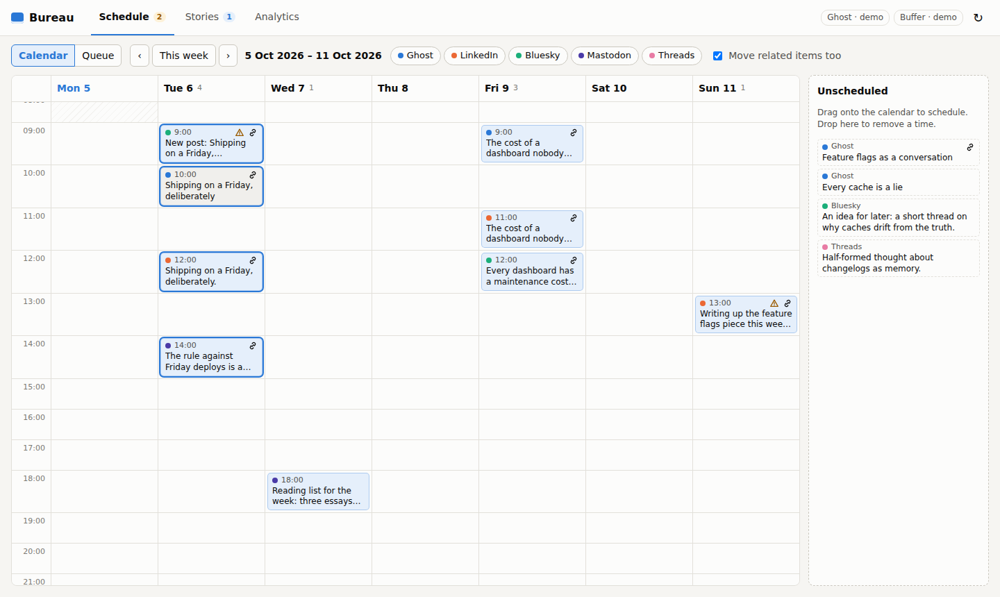

# Bureau

A desk for publishing across Ghost and Buffer. Bureau shows every queued item
on one calendar, works out which items belong together (a Ghost article and
the LinkedIn, Bluesky and Mastodon posts that share it), and reports how they
performed, overall, by platform and by post. An MCP server lets an AI
assistant analyse the same numbers.



## What it does

- **Schedule.** A week calendar of every scheduled item across Ghost and every
  Buffer channel. Drag an item to another hour or day to move it, drag an
  unscheduled draft onto the calendar to give it a time, or drop an item on the
  _Unscheduled_ tray to take its time away. Every change can be undone from the
  notification that confirms it.
- **Manual entry.** Click any item for a details panel with a date-time field,
  quick nudges (-1h, +1h, +1 day, +1 week) and _Remove time_. The _Queue_ view
  lists every unpublished item with its own time field, for bulk edits by
  keyboard.
- **Relationships.** Bureau links a social post to a Ghost article when it
  shares the article's URL or slug, which works even before the article is
  published. Posts sharing the same outside link are grouped too. Posts with no
  link that repeat an article's title are offered as suggestions to confirm or
  dismiss. In the _Stories_ view you can drag an unlinked item onto a story, or
  tick several items to link them.
- **Timing checks.** A social post scheduled before its article goes live, or
  for an article with no time yet, is flagged on the calendar and in the story.
- **Moving a story together.** With _Move related items too_ on, moving an
  article moves its scheduled social posts by the same amount.
- **Analytics.** Totals (views, followers, engagements, engagement rate, email
  opens, sign-ups), a per-platform breakdown, per-channel follower counts,
  cross-platform story totals and a sortable per-post table with every metric.
- **AI analysis.** A read-only MCP server exposes the analytics, the schedule
  and the relationships to any MCP client.

Editing an item's content is deliberately out of scope: Bureau only adds,
changes or removes publishing times.

## Quick start

Needs Node 22.9 or newer.

```sh
npm install
npm run dev        # API on :8787, UI on http://localhost:5173
```

With no credentials Bureau runs on demo data for both integrations (the badges
in the top right say `demo`). The demo is seeded relative to the day you first
run it and stored in `data/`; delete `data/mock-*.json` to reseed.

For a production build:

```sh
npm run build
npm start          # UI and API on http://localhost:8787
```

## Connecting Ghost and Buffer

Copy `.env.example` to `.env`. Each integration is independent: configure one
and the other stays on demo data.

| Variable                                         | What it is                                                                                            |
| ------------------------------------------------ | ----------------------------------------------------------------------------------------------------- |
| `GHOST_ADMIN_API_URL`                            | Your site's URL                                                                                       |
| `GHOST_ADMIN_API_KEY`                            | Admin API key from a custom integration (Ghost Admin, Settings, Integrations), in `id:secret` form    |
| `BUFFER_API_KEY`                                 | From [publish.buffer.com/settings/api](https://publish.buffer.com/settings/api)                       |
| `BUFFER_ORGANIZATION_ID`                         | The Buffer organisation to read                                                                       |
| `BUREAU_MOCK`                                    | `1` forces demo data for both                                                                         |
| `PORT`, `BUREAU_DATA_DIR`, `BUREAU_HISTORY_DAYS` | Server port (8787), where Bureau keeps its state (`data/`), how far back to load published items (90) |

How each service maps onto Bureau:

- **Ghost.** Scheduling sets a post's `status` to `scheduled` with a future
  `published_at`; removing a time sets it back to `draft`. Bureau never sends a
  `newsletter`, so scheduling a draft from Bureau publishes it to the web only;
  posts scheduled in Ghost Admin with a newsletter keep it when their time
  moves. Followers are the site's member count. Email opens, clicks, sign-ups
  and paid conversions come from the Admin API. Page views come from Ghost 6's
  stats endpoint, which is not part of the documented Admin API: if your site
  does not answer it, Ghost views are simply left out.
- **Buffer.** Uses Buffer's GraphQL API. Moving a time is `editPost` with a
  custom `dueAt`; removing a time moves the post to drafts. Metrics come from
  each post's `metrics`. Buffer's API reports no follower counts, so enter them
  on the _Analytics_ page; Bureau records when you did.

Bureau has no login of its own and can move your scheduled posts, so the
server listens on `127.0.0.1` only. Set `HOST` to expose it, and only behind
something that authenticates.

## AI analysis over MCP

`npm run mcp` (after `npm run build`) starts the MCP server on stdio, against
the same configuration and data directory as the web app. For Claude Desktop or
Claude Code, add:

```json
{
  "mcpServers": {
    "bureau": {
      "command": "npm",
      "args": ["--prefix", "/path/to/bureau", "--silent", "run", "mcp"]
    }
  }
}
```

| Tool                     | Returns                                                              |
| ------------------------ | -------------------------------------------------------------------- |
| `get_analytics_summary`  | Overall totals and a one-line-per-platform summary, for a date range |
| `get_platform_breakdown` | Per-platform totals with each channel's followers and their source   |
| `list_post_metrics`      | Published items with metrics, filtered by platform and sorted        |
| `get_post_analytics`     | One item, every item related to it, and the story's combined totals  |
| `list_stories`           | Cross-platform stories ranked by views                               |
| `get_schedule`           | Upcoming and unscheduled items with timing warnings and suggestions  |
| `get_metrics_history`    | Follower, view and engagement snapshots over time                    |

There is also a `performance_review` prompt that walks an assistant through a
review of the last N days. All tools are read-only.

## How it fits together

```
src/core/     Domain types, relationship detection, analytics (shared by everything)
src/server/   Bureau service, Ghost/Buffer providers, mock providers, JSON API (Hono)
src/mcp/      MCP server over the same Bureau service
src/web/      React UI (Vite, dnd-kit)
test/         Vitest suites for core, providers, service, API and MCP
docs/adr/     Architecture decisions (see 0002 for the stack)
```

The JSON API, for reference:

| Method   | Path                          | Body                                              |
| -------- | ----------------------------- | ------------------------------------------------- |
| `GET`    | `/api/overview`               | Channels, items, stories, suggestions             |
| `PUT`    | `/api/items/:id/schedule`     | `{ "scheduledAt": iso \| null, "cascade": bool }` |
| `POST`   | `/api/relationships`          | `{ "itemIds": [...] }`                            |
| `DELETE` | `/api/relationships/:id`      | Removes a manual link or rejects a detected one   |
| `PUT`    | `/api/channels/:id/followers` | `{ "followers": number \| null }`                 |
| `GET`    | `/api/analytics`              | `?from=&to=&refresh=1`                            |
| `GET`    | `/api/analytics/history`      | Snapshots                                         |
| `GET`    | `/api/changes`                | Recent schedule changes                           |

## Everyday commands

```sh
npm run dev           # API and UI with reload
npm test              # unit and integration tests
npm run typecheck     # server, tests and UI
npm run build         # UI to dist/web, server to dist/
npm run format        # Prettier
npm run lint:commits  # commitlint since origin/main
```

## Licence

[MIT](LICENCE.md)
